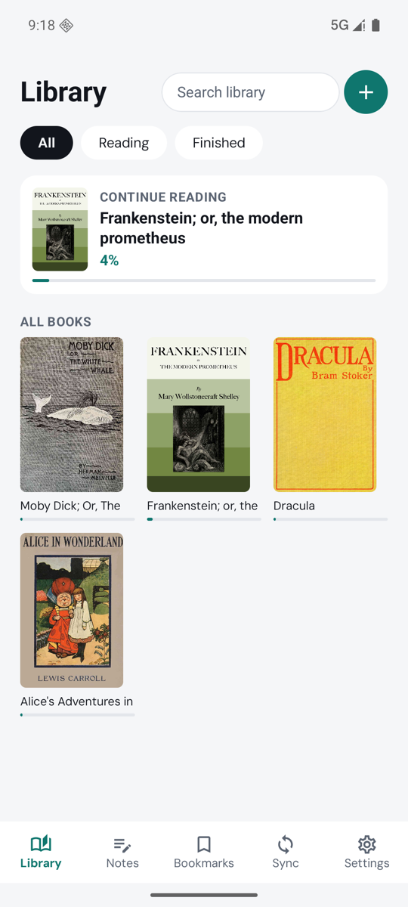
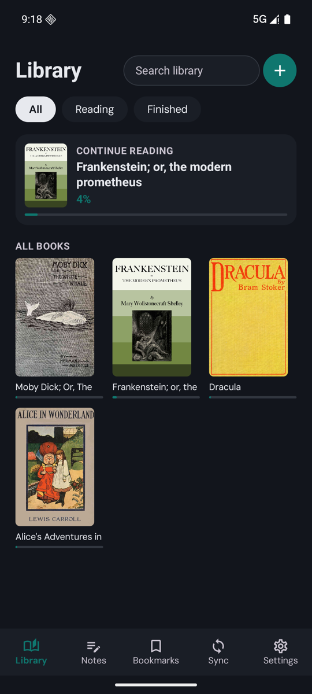
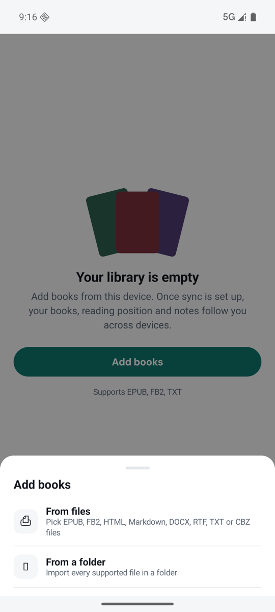
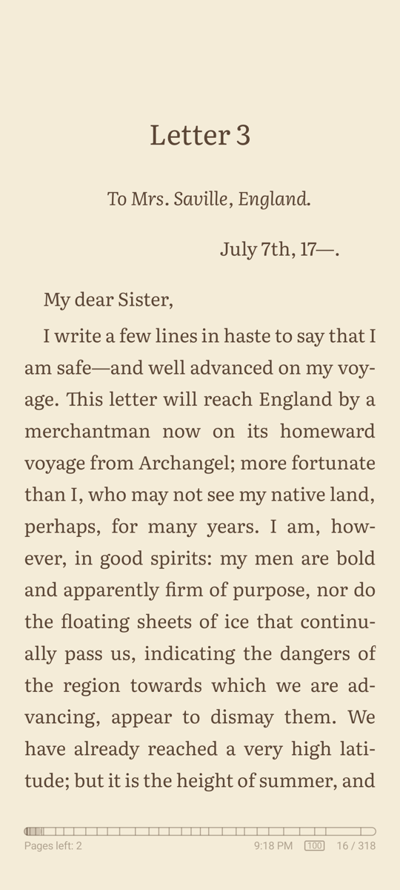
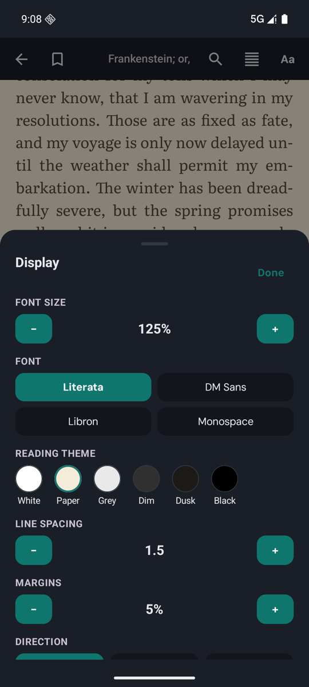
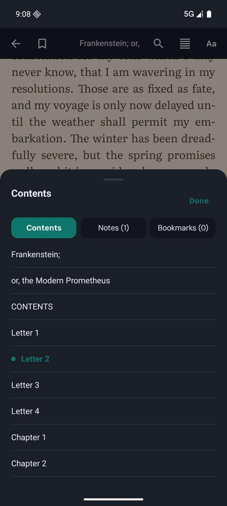
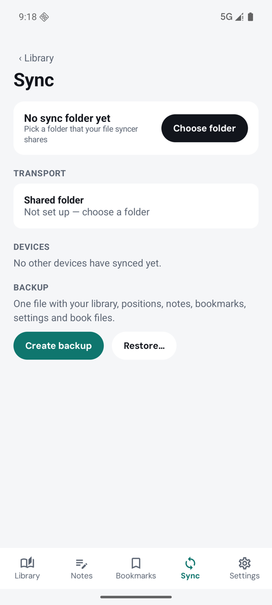
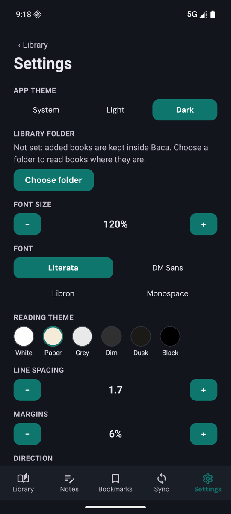

# Baca

An e-reader for Android and desktop that keeps your place, highlights, notes and bookmarks in step across devices, without an account or a server. Sync goes through a folder you already share between your devices, such as one kept in sync by Syncthing, Dropbox or iCloud Drive.

Built with Kotlin Multiplatform and Compose Multiplatform. iOS is planned.

## Preview

| Library | Library, dark theme | Add books |
|---|---|---|
|  |  |  |

| Reader | Display settings | Contents |
|---|---|---|
|  |  |  |

| Sync and backup | Settings |
|---|---|
|  |  |

Screenshots are from the Android app, with public-domain books from [Project Gutenberg](https://www.gutenberg.org).

## Features

- **Formats:** EPUB, FB2 (including `.fb2.zip`), TXT, HTML, Markdown, RTF, DOCX and CBZ comics.
- **Reader:** paged layout with justified paragraphs and first-line indents; six reading themes (White, Paper, Grey, Dim, Dusk, Black); font, size, line spacing and margins; contents and chapter jumps; in-book search; arrow keys turn pages on desktop.
- **Reader options:** text direction (auto, left to right, right to left), two columns, and scrolled flow instead of pages; under Advanced, custom CSS and find and replace in the book's text. Right-to-left and vertical (Japanese) books are supported.
- **Notes:** highlights, notes and bookmarks, listed per book in the reader and across all books on the Notes and Bookmarks screens.
- **Sync:** each device writes its own JSON files into the shared folder; merges are conflict-free and order edits with Lamport clocks rather than wall time. Different files of the same EPUB edition are linked, so your place carries over even if each device has its own copy.
- **Backup:** one `.zip` with your library, positions, notes, settings and book files, restorable on any device.
- **App theme:** follow the system, or force light or dark.

Book files themselves don't sync. Import the book on each device; positions and notes then match up automatically.

## Install

### Android

Requires Android 8.0 (API 26) or newer. There is no store release yet, so build the APK from source (see [Build from source](#build-from-source)):

```bash
./gradlew :android:assembleDebug
```

The APK is `android/build/outputs/apk/debug/android-debug.apk`. Copy it to the phone and open it (allow installs from that source when asked), or install it over USB with the phone's developer options on:

```bash
adb install -r android/build/outputs/apk/debug/android-debug.apk
```

`./gradlew :android:assembleRelease` builds a release APK. It is signed only if a git-ignored `keystore.properties` sits in the repo root (`storeFile`, `storePassword`, `keyAlias`, `keyPassword`); otherwise it is unsigned and Android won't install it.

### Desktop

Run it straight from source:

```bash
./gradlew :desktop:run
```

Or build an installer for the system you are on (output under `desktop/build/compose/binaries/main/`):

```bash
./gradlew :desktop:packageDmg    # macOS
./gradlew :desktop:packageMsi    # Windows
./gradlew :desktop:packageDeb    # Linux
```

Installers are built per platform: a `.dmg` is built on a Mac, an `.msi` on Windows, a `.deb` on Linux.

## First steps

1. **Add books.** Tap **+** in the Library and pick files or, on desktop, a folder. Baca copies each book into its own storage.
2. **Or use a library folder.** In Settings, pick a folder of books. Baca reads them where they are, never copies them, and rescans on launch.
3. **Sync.** On the Sync screen, pick a folder that your devices already share (Syncthing, Dropbox, iCloud Drive…). Do this on every device. Positions, highlights, notes and bookmarks then follow you. Book files don't: add each book on each device.
4. **Backup.** The Sync screen also creates and restores a `.zip` backup.

## Build from source

Requires JDK 17 or newer. The Android build also needs the Android SDK (set `sdk.dir` in `local.properties`). Use the Gradle wrapper (`./gradlew`); nothing else needs installing.

```bash
./gradlew :desktop:run                     # run the desktop app
./gradlew :android:assembleDebug           # build the Android debug APK
```

Tests:

```bash
./gradlew :shared:jvmTest                  # shared logic
./gradlew :composeApp:desktopTest          # Compose UI, headless
./gradlew :composeApp:compileAndroidMain   # Android code compiles
```

On desktop, the library database is `~/.baca/baca.db`, and imported books are stored in `~/.baca/books`.

## Project layout

| Module | Contents |
|---|---|
| `shared/` | Platform-independent logic: book parsers, pagination, reader session, sync merge and boundary, SQLDelight database, backup |
| `composeApp/` | Compose UI shared by Android and desktop, plus small platform pieces (file pickers, sync folder access) |
| `android/` | Android app entry point |
| `desktop/` | Desktop app entry point |

## Documentation

- [`docs/TECH.md`](docs/TECH.md): design reference covering formats, positions, sync rules, backup and the UI guide.
- [`AGENTS.md`](AGENTS.md): conventions and rules for contributors, human or AI.

## Fonts

Bundled reading fonts are Literata, DM Sans and [Libron](https://github.com/nicoverbruggen/libron), all under the SIL Open Font License 1.1. License texts are in [`docs/licenses`](docs/licenses).

## Acknowledgements

- [Librera](https://librera.mobi): Baca's pages are laid out to match Librera's reader, page for page. Its layout rules, page numbering and reading themes are the reference Baca's layout is checked against.
- [foliate-js](https://github.com/johnfactotum/foliate-js) by John Factotum (MIT License): Librera's reader is built on it, and Baca follows its rules for pagination, page numbering (locations) and FB2 conversion. The FB2 stylesheet in `shared/parser/Fb2.kt` is taken from its `fb2.js` ([license](docs/licenses/MIT-foliate-js.txt)).
- English hyphenation patterns from the TeX hyphenation project ([`docs/licenses/hyph-en-us.txt`](docs/licenses/hyph-en-us.txt)). On Android, other languages are hyphenated with the system's own patterns.
